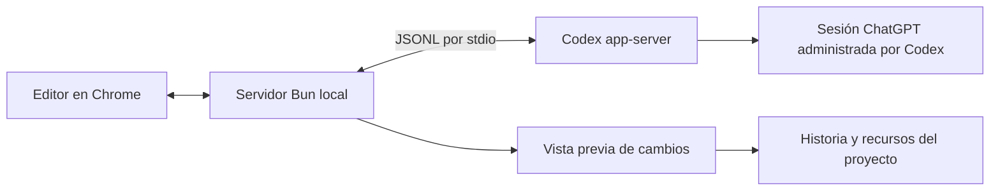

# Integración de Codex CLI con el editor

Revisión del **13 de noviembre de 2026**, para el fork personal local de Toonflow. **La revisión del protocolo está realizada; el adaptador del editor todavía no está implementado. No se inició ningún turno de inferencia ni se generaron imágenes durante esta revisión.**

## Conclusión y corrección de la revisión inicial

Podemos diseñar la integración para texto y para la herramienta de imágenes integrada en Codex. La documentación actual permite generar y editar imágenes desde el CLI, incluyendo referencias visuales. El `--image` del CLI adjunta una referencia; la generación es una herramienta del agente. [Generación de imágenes oficial](https://learn.chatgpt.com/docs/image-generation).

La autenticación con ChatGPT utiliza el acceso de la suscripción; la clave de API corresponde a otra modalidad de facturación. [Autenticación oficial](https://learn.chatgpt.com/docs/auth). Las imágenes consumen el cupo general de Codex, aproximadamente 3–5 veces más rápido que turnos similares sin imágenes, según tamaño y calidad. Después del cupo pueden entrar en juego créditos disponibles. [Uso y límites](https://learn.chatgpt.com/docs/pricing).

La revisión preliminar remitía a las limitaciones de otro flujo, Sign in with ChatGPT para aplicaciones con tokens externos. Esas limitaciones no establecen qué puede hacer el CLI local autenticado normalmente. Esta revisión comprueba esa distinción y sustituye la incertidumbre anterior sobre las imágenes.

## Comprobaciones en esta PC

Se utilizó la instalación existente de `codex-cli 0.163.0`, sin actualizarla ni modificar su configuración:

| Comprobación sin inferencia | Resultado |
| --- | --- |
| `codex login status` | Inicio de sesión mediante ChatGPT. Se consultó el estado del CLI; las credenciales no se incorporaron al editor. |
| Inicio de `app-server` por `stdio` e intercambio `initialize` / `initialized` | Correcto. El proceso de revisión se cerró al terminar. |
| `account/read`, con `refreshToken: false` | Tipo de cuenta `chatgpt`. No se guardaron correo, identificadores ni tokens en el informe. |
| `modelProvider/capabilities/read` | `imageGeneration: true`, `webSearch: true`. |
| `account/rateLimits/read` | Consulta correcta; no se publicaron datos de uso personales. |
| Esquemas generados por el propio CLI | Hay eventos `imageGeneration` y parámetros de salida estructurada en `turn/start`. |

La capacidad declarada por el proveedor y la presencia del esquema **no equivalen a haber probado una generación real**. Falta validar un turno de texto y una imagen con esta cuenta, con un pedido concreto del usuario y sin activar una API paga como alternativa.

La evidencia resumida sin credenciales está en `localRuntime/codexCapabilities.json`; los esquemas de la versión instalada, en `localRuntime/codexProtocol/`. Ambos quedan fuera de Git. No hay que copiar estos esquemas completos al producto: al implementar se tomarán los tipos necesarios y se fijará la versión compatible.

## Arquitectura propuesta

OpenAI ofrece `codex app-server` para integrar clientes con historial, autenticación, aprobaciones y eventos progresivos. `stdio` es su transporte local predeterminado. Tiene cancelación y consultas de cuenta y límites. La API contiene funciones experimentales, por lo que conviene trabajar con el esquema de la versión instalada. [Protocolo oficial](https://learn.chatgpt.com/docs/app-server).

El siguiente diseño es una propuesta para este editor:

El editor tendría una opción **Codex · ChatGPT**. El backend mantendría el proceso del CLI y traduciría sus eventos al panel; las credenciales seguirían gestionadas por Codex. La conversación se vincularía al proyecto mediante un identificador de thread. La interfaz mostraría conexión, modalidad, límites, actividad y cancelación.

La primera versión enviaría la premisa, personajes y beats elegidos, incluyendo el estado todavía abierto en el panel. Para texto pediría una propuesta con estructura JSON validada. El usuario vería los cambios antes de aplicarlos; el guardado usaría la revisión original de `story.json` y conservaría el contenido si otra ventana lo modificó. No se aplicarían cambios a otro proyecto si el usuario cambia de carpeta mientras espera.

El control de cupo debe ser explícito: mostrar cuántas imágenes se solicitan, consultar límites y detener una cola cuando se notifique agotamiento. Las otras sesiones de Codex comparten uso; una lectura previa no garantiza cuánto cupo quedará al finalizar. No se debe presentar este acceso como «gratis e ilimitado», prometer gasto cero con créditos activos ni habilitar un cambio automático a API paga.

## Qué aprovechar para la creación

| Área | Acciones propuestas | Resultado en el editor |
| --- | --- | --- |
| Guion | Premisa y sinopsis; escaleta; alternativas de diálogo; adaptación a una duración; revisión de continuidad | Texto editable y propuestas de beats, sin perder la versión anterior. |
| Estructura al estilo Causality | Examinar causa y efecto, motivaciones, preparación y consecuencias; señalar beats aislados o reordenamientos | Observaciones asociadas a IDs de beats y cambios revisables en «Provocado por». |
| Personajes al estilo STARC | Ficha de deseo, conflicto, arco, voz y relaciones; contradicciones entre ficha y guion | Propuestas sobre la ficha existente y retratos asociados al personaje. |
| Storyboard de texto | Desglosar cada beat en planos, encuadre, acción, duración, cámara, sonido y diálogo | Lista de planos vinculados al beat de origen y preparada para crear nodos. |
| Storyboard visual | Generar un boceto por plano; variar encuadre o luz; editar un boceto conservando las referencias aprobadas | Imágenes versionadas, con referencia al plano, personajes y prompt. |
| Referencias 3D | Usar una captura de Dirección 3D como guía de composición junto con imágenes de personajes y estilo | Una base visual para la generación; requiere revisar que respete el encuadre y la identidad. |
| Animatic | Ordenar imágenes y duraciones aprobadas y ensamblarlas con FFmpeg local | Video de previsualización sin necesitar un modelo generador de video. |

Para continuidad visual conviene conservar retratos aprobados, vestuario, paleta y una guía de estilo del proyecto. Se reutilizarían como referencias en cada plano. Esto mejora la consistencia, pero no garantiza identidad o geometría perfectas entre generaciones.

Los esquemas locales describen el evento `imageGeneration` con `status`, `result`, `savedPath` opcional, `revisedPrompt` y un fallo de cupo. El adaptador preferiría el archivo devuelto cuando exista, comprobaría formato y tamaño y lo copiaría con un nombre nuevo dentro de los recursos del proyecto. Debe manejar también la ausencia de `savedPath`, los errores y la cancelación; no adivinar la codificación de `result` ni aceptar cualquier ruta como recurso importable.

No se verificaron generación nativa de video, voz o música mediante la suscripción en este CLI. El animatic propuesto utiliza medios existentes y FFmpeg. Los proveedores de video y audio de Toonflow requieren su propia revisión de disponibilidad y costos.

## Qué reutilizar y qué agregar

La inspección del repositorio muestra:

- `apps/server/src/agent/runtime/model.ts` utiliza el motor de agentes de Pi y la configuración de proveedores de Toonflow. Integrar Codex necesita un adaptador de ejecución propio; no consiste solamente en añadir un modelo al selector actual.
- `packages/mcp` ya ofrece a agentes externos estado de la aplicación, consultas del lienzo, operaciones de nodos y transferencia de archivos. Su interruptor está apagado de forma predeterminada; no se habilitó durante la revisión.
- `packages/tools/canvas/src/runtime.ts` expone operaciones como `getCanvas`, `addNode`, `connectNodes`, `getNodeTools` y `nodeTools`. Se pueden reutilizar para crear y actualizar el storyboard en la interfaz abierta.
- `apps/web/src/pages/workspace/panels/storyPanel.vue` ya valida la historia y guarda con revisiones, pero todavía no ofrece una interfaz de herramientas para beats y personajes.

Para el primer alcance propongo agregar el puente del CLI en el servidor, el estado de conexión y las acciones de propuesta en el panel narrativo. El resultado se aplicaría con el guardado existente. En una etapa posterior se expondrían herramientas acotadas de historia y lienzo a Codex, filtrando por proyecto y operación; una operación que invoque al agente de Toonflow con un proveedor pago no debe colarse en ese recorrido.

## Orden recomendado de implementación

1. **Texto:** conectar la sesión existente, mostrar cuenta/modalidad y límites, enviar contexto seleccionado, recibir propuestas progresivas y permitir cancelación. Tres acciones iniciales: «Analizar estructura», «Desarrollar personaje» y «Desglosar en planos».
2. **Aplicación de cambios:** vista previa y aceptación por cambios, validación de IDs y relaciones y protección frente a revisiones antiguas. Conservar las propuestas rechazadas o fallidas sin sobrescribir el proyecto.
3. **Imágenes:** validar una generación y una edición con referencia mediante la herramienta integrada; importar el resultado y conservar versiones. Empezar por un retrato y un plano, con solicitud explícita.
4. **Producción:** crear nodos del storyboard a partir de los planos aprobados, vincular recursos y preparar el animatic. Incluir acciones por selección para no regenerar el proyecto completo por un cambio pequeño.

Esta revisión no agrega botones ficticios, adaptadores de producción ni cambios a las credenciales. Deja definido qué se comprobó, qué se reutiliza y cómo implementar la siguiente etapa sin reemplazar el editor de nuevo.
